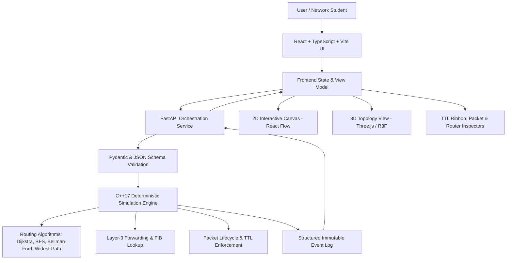

# NetTrace 3D — Network Routing, Protocol Simulation and Visualization Platform

**NetTrace 3D** is an interactive, web-based network laboratory where users can construct simulated networks, inject packets, inspect per-hop forwarding decisions, reproduce network failures, and compare routing algorithms and metrics in both 2D and 3D.

> **Status:** Under active, incremental development. Features are strictly labeled as implemented, partial, planned, or not modeled. No synthetic or mock simulation data is presented as real engine outcomes.

---

## 1. System Architecture

NetTrace 3D is designed with strict separation of concerns across three core layers:



### Authoritative Responsibilities
- **C++17 Engine (`engine/`)**: Authoritative for graph modeling, routing calculations, per-router FIB lookups, packet state transitions, deterministic loss/delay, TTL decrements, ICMP generation, and structured event emission.
- **FastAPI Backend (`backend/`)**: Schema validation, process orchestration, engine invocation via typed JSON IPC, and run history persistence.
- **React Frontend (`frontend/`)**: Interactive 2D/3D visualization, timeline playback cursor, packet/router state inspectors, and experiment configuration.

---

## 2. Core Documentation

- [PROJECT.md](PROJECT.md): Primary product specification, functional scope, and non-negotiable principles.
- [ARCHITECTURE.md](ARCHITECTURE.md): Component boundaries, IPC protocols, and data contracts.
- [DESIGN.md](DESIGN.md): Visual design system, "instrument bench" aesthetic, TTL ribbon, and design tokens.
- [NETWORKING_RULES.md](NETWORKING_RULES.md): Authoritative networking semantics, IPv4/TTL order of operations, and simulation assumptions.
- [TASKS.md](TASKS.md): Step-by-step milestone checklist, acceptance criteria, and completion reports.
- [docs/status.md](docs/status.md): Real-time feature status board.
- [docs/traceability.md](docs/traceability.md): Requirements-to-tests traceability matrix.
- [docs/decisions/](docs/decisions/): Architectural Decision Records (ADRs D-01 through D-20).

---

## 3. Toolchain & Prerequisites

Exact confirmed local toolchain versions:
- **C++ Compiler:** GCC 16.2.0 (`x86_64-w64-mingw32` via MSYS2 UCRT64).
- **C++ Build System:** CMake 4.4.4 and GNU Make 4.4.1 (`mingw32-make.exe`).
- **Backend Runtime:** Python 3.14.0 with FastAPI, Pydantic v2, and Pytest.
- **Frontend Runtime:** Node.js v24.11.0 and npm 11.6.1.

---

## 4. Getting Started

### Building the C++ Engine
```bash
cd engine
python -m cmake -B build -G "MinGW Makefiles" -DCMAKE_BUILD_TYPE=Release
cmake --build build
ctest --test-dir build --output-on-failure
```

### Running Backend Tests
```bash
cd backend
python -m pytest tests/ -v
```

### Running Frontend Tests
```bash
cd frontend
npm test
```

---

## 5. Development Milestones

- **M0: Repository Inspection, Toolchain & Planning** *(Complete)*
- **M1: C++ Graph & Routing Algorithms (Dijkstra, BFS, Bellman-Ford, Widest-Path)** *(Next)*
- **M2: C++ Topology Modeling & Forwarding Logic**
- **M3: Packet Lifecycle, TTL Semantics & Structured Events**
- **M4: C++ CLI Executable & JSON IPC**
- **M5: FastAPI Backend Orchestration & Validation**
- **M6: React 2D Interface & State Inspectors**
- **M7: Six Routing Criteria & Algorithm Comparison**
- **M8: Network Failure Injection & Impairment Simulation**
- **M9: 3D Topology Visualization**
- **M10: End-to-End Verification, Demos & Polish**
